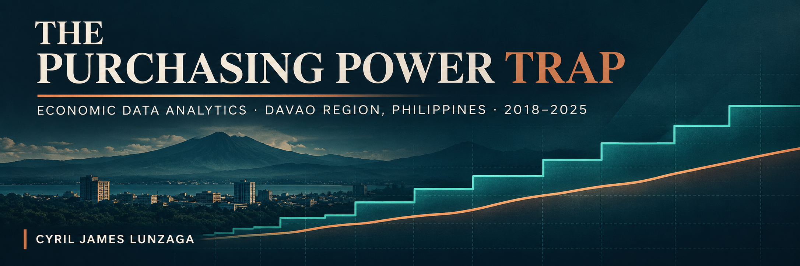
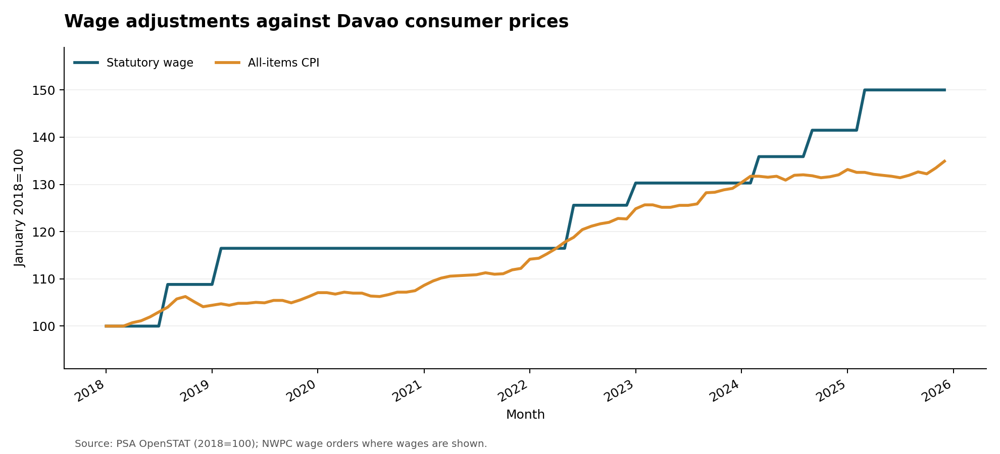
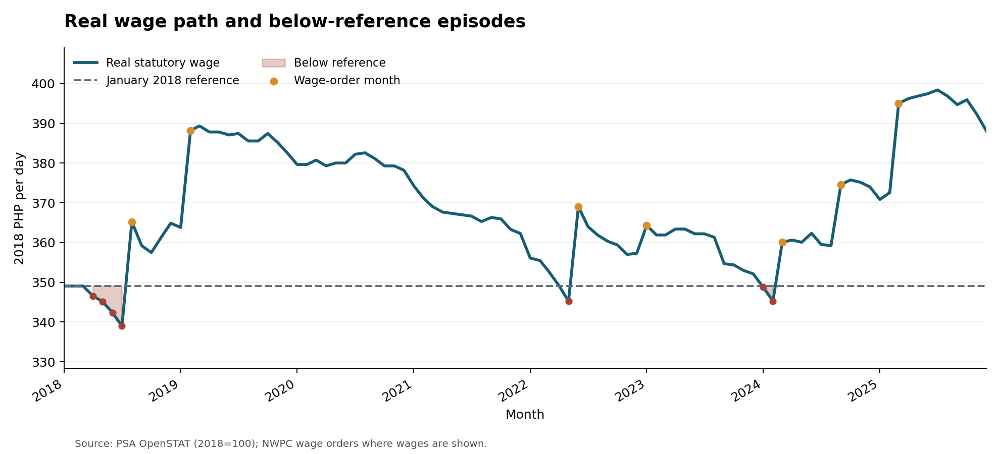
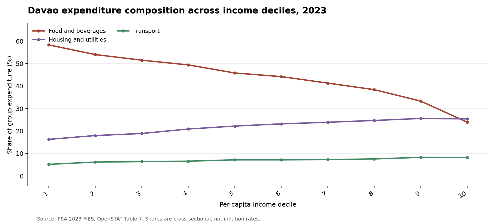
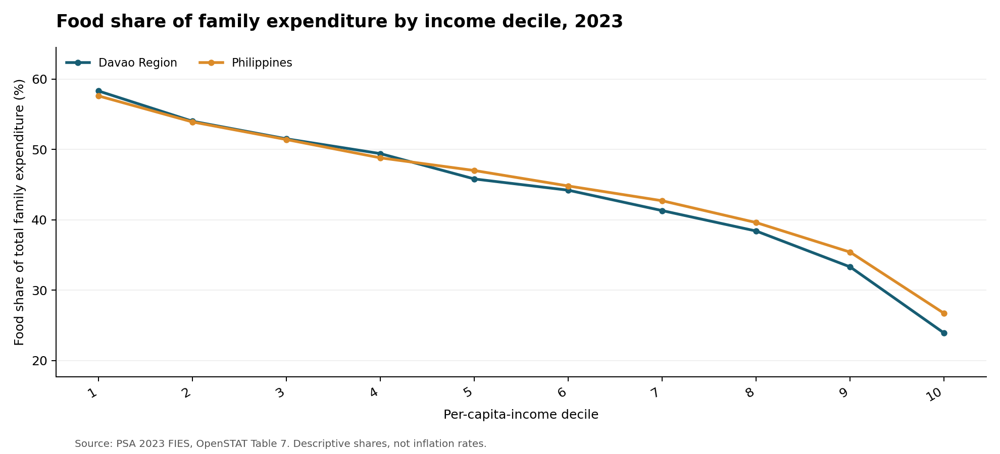

# The Purchasing Power Trap



**Cyril James Lunzaga**
Economic data analytics · Davao Region, Philippines · January 2018–December 2025

> **Research question:** Did the statutory minimum wage keep pace with prices, and what does household expenditure composition reveal about the uneven importance of essential costs?

*The banner is conceptual artwork, not a chart of measured results. All figures below are computed from official observations.*

## Executive finding

**The endpoint does not show a decline in the purchasing power of the selected statutory wage benchmark.** Region XI's selected non-agricultural daily minimum-wage rate increased by **50.00%** between January 2018 and December 2025, while regional all-items CPI increased by **34.91%**. The resulting real daily wage increased **11.19%** in constant 2018 pesos. This does **not** establish that actual employees or households experienced a comparable gain.

| Measure | January 2018 | December 2025 | Endpoint change |
| --- | ---: | ---: | ---: |
| Selected statutory non-agricultural wage | ₱340/day | ₱510/day | +50.00% |
| Davao Region all-items CPI (2018=100) | 97.4 | 131.4 | +34.91% |
| Statutory real wage (2018 PHP/day) | ₱349.08 | ₱388.13 | **+11.19%** |
| Food-deflated statutory real wage (2018 PHP/day) | ₱348.00 | ₱380.60 | +9.37% |

The **2018 CPI base** is the full-year 2018 average; **January 2018=100** is a separate indexing convention used in selected charts.



## Why the endpoint is not the whole story

The real-wage series fell below its January 2018 reference in **seven months**, split across three episodes; the longest lasted **four months** (April–July 2018). The lowest month relative to that initial reference was **July 2018, at −2.89%**. Separately, the largest decline from a *previous observed monthly peak* was **−11.33%**, from March 2019 to May 2022. These reference points answer different questions and should not be conflated.



The wage schedule uses the **rate legally in force at month end**. A separate calendar-day-weighted series tests how the treatment of mid-month wage changes affects monthly estimates. For June 2022, this yields **₱427** at month end versus **₱408.40** as a calendar-day average. Neither convention measures actual paid days.

## Income-decile context: 2023 FIES

The official [2023 PSA Family Income and Expenditure Survey Table 7](https://openstat.psa.gov.ph/PXWeb/pxweb/en/DB/DB__1E__IE/0071E3ATME0.px) provides spending composition for families grouped by *per-capita income decile*. In Davao Region, food and non-alcoholic beverages accounted for **58.3%** of total family expenditure in the first decile, compared with **23.9%** in the tenth decile: a **34.4-percentage-point** difference. Food, housing/utilities, and transport combined represented **79.8%** in the first decile and **57.5%** in the tenth.





These are **2023 cross-sectional survey expenditure shares**, not observed individual purchasing power, worker incomes, monthly spending, or household-specific inflation. They provide distributional context; they are **not merged into** the 2018–2025 wage/CPI series or used to construct an unsupported custom CPI.

## Study design and sources

The study joins Region XI statutory wage-order events to the **96 monthly dates** from January 2018 to December 2025, then deflates the legal wage benchmark using PSA monthly CPI. The Philippines is included as a **price comparator**, not a national wage comparison. Additional groups are food and non-alcoholic beverages, housing and utilities, and transport.

| Official source | Role | Captured coverage |
| --- | --- | --- |
| [PSA OpenSTAT 2018-base CPI](https://openstat.psa.gov.ph/PXWeb/api/v1/en/DB/2M/PI/CPI/2018NEW/0012M4ACP22.px) | Prices and category comparisons | 768 observations: two geographies × four categories × 96 months |
| [PSA purchasing power of the peso](https://openstat.psa.gov.ph/PXWeb/api/v1/en/DB/2M/PI/CPI/2018NEW/0012M4ACP24.px) | Independent rounded-value check on `100 / CPI` | 192 observations |
| [NWPC historical wage schedule](https://nwpc.dole.gov.ph/summary-of-daily-minimum-wage-rates-per-wage-order-by-region-non-agriculture-1989-present/) and [Region XI original orders](https://nwpc.dole.gov.ph/region-xi/) | Effective-dated statutory wage benchmark | Eight events, original orders XI-19 through XI-23 audited |
| [PSA FIES Table 7](https://openstat.psa.gov.ph/PXWeb/pxweb/en/DB/DB__1E__IE/0071E3ATME0.px) | 2023 family expenditure composition | 176 values, two geographies × eleven income groups × eight selected categories |

Historical order XI-19's **₱340** rate includes COLA; the larger-establishment benchmark had different treatment from small retail/service establishments before the wage schedule converged in April 2023. The study does not claim that every non-agricultural worker received the plotted rate. The study endpoint is **December 2025**; subsequent 2026 wage orders are intentionally outside scope.

See [data sources and attribution](docs/data_sources.md), [wage-order audit](docs/wage_order_audit.md), and [methodology](docs/methodology.md) for definitions, original links, checksums, eligibility notes, and limitations.

## Measures and quality assurance

The primary metric is:

\[
\text{Real statutory wage}_{t,2018\text{ PHP}} = \text{Nominal statutory wage}_t\,\frac{100}{\text{CPI}_t}.
\]

The pipeline also calculates month-on-month and year-over-year CPI changes, cumulative inflation from January 2018, `100 / CPI`, indexed nominal wages and prices, below-baseline episodes, peak-to-trough drawdown, wage-event windows, food-deflator sensitivity, and the nominal/price ratio decomposition.

Quality controls cover **completeness, accuracy, consistency, integrity, and validation**: full 96-month coverage, missing/duplicate keys, positive numerical values, CPI 2018-base checks, wage effective-date and audit reconciliation, source SHA-256 checks, FIES category/decile coverage, FIES expenditure totals and weighted-share reconciliation, and official PPP rounding. The captured extract shows **zero missing or duplicate monthly keys**; maximum PPP discrepancy is **₱0.00498** within the **₱0.006** tolerance. See [the reproducible evidence record](docs/project_progress.md).

The analysis is descriptive. It does not estimate causal wage effects, compliance, working days actually paid, employment, poverty, or household-specific cost-of-living exposure. No synthetic values are used as research observations.

## Reproduce the analysis

The repository contains **small, source-attributed frozen input snapshots** under `data/frozen/`, with a verified SHA-256 manifest. These enable results to be reproduced in a fresh clone even when live PSA APIs or the NWPC website are unavailable. Downloaded raw documents and responses remain ignored under `data/raw/`.

Use Python **3.9 or newer** with compatible dependencies. The project has been successfully tested in a fresh Windows Python 3.9 virtual environment using pandas 2.3.3, NumPy 2.0.2, Matplotlib 3.9.4, and Requests 2.32.5. The editable installation, dependency verification, frozen-data pipeline, all 28 automated tests, and release verification passed. The analytical results were reproduced from the checksum-verified frozen datasets. See the [progress record](docs/project_progress.md).

```powershell
cd "E:\Machine Learning\The Purchasing Power Trap"
git clone https://github.com/cymesdebugger67/economical-analysis-the-purchasing-power-trap.git
cd economical-analysis-the-purchasing-power-trap

python -m venv .venv
.\.venv\Scripts\python.exe -m pip install --upgrade pip setuptools
.\.venv\Scripts\python.exe -m pip install -e .
.\.venv\Scripts\python.exe scripts/run_analysis.py --source frozen
.\.venv\Scripts\python.exe -m unittest discover -s tests -v
```

To rerun against the **original locally captured vintage**, use `python scripts/run_analysis.py --source captured` if your ignored `data/raw/` files are still available. To acquire into a **new, timestamped vintage**, use `python scripts/run_analysis.py --refresh-vintage` with network access. A live refresh is **not** automatically equivalent to the frozen baseline; compare metadata and hashes before updating any findings. `--acquire` is for an empty `data/raw/` and deliberately refuses to overwrite a captured vintage. `python scripts/create_frozen_inputs.py` rebuilds snapshots from verified captured files, but refuses to overwrite the checked-in baseline without an explicit `--replace`.

The notebook [`notebooks/purchasing_power_analysis.ipynb`](notebooks/purchasing_power_analysis.ipynb) reads validated pipeline outputs and adds interpretation. Other charts, source checks, and reports are located in [`reports/figures/`](reports/figures/) and [`reports/tables/`](reports/tables/).

## Project structure

```text
assets/                  Project banner
src/purchasing_power/    Source extraction, validations, analysis, visualization, frozen-data loading
scripts/                 Pipeline execution and frozen-data snapshot builder
data/frozen/             Source-attributed selected observations and checksum manifest
data/reference/          Effective-dated wage benchmark and original-order event audit
data/raw/                Ignored captured source responses and original PDFs (optional)
data/processed/          Ignored generated monthly analytical tables
reports/figures/         Publication figures and QA contact sheet
reports/tables/          Publication-ready summary and validation tables
notebooks/               Notebook analytical walkthrough
docs/                    Methods, sources, evidence, wage legal scope
tests/                  Offline unit and integration-contract tests
```

## Interpretation and conclusion

For the *selected statutory benchmark*, the endpoint evidence rejects a simple narrative of uninterrupted real-wage erosion: the series ends **11.19%** above its January 2018 real level. Still, temporary erosion episodes and the **−11.33% peak-to-trough drawdown** show that outcomes depend on *when* the comparison is made. The FIES context independently shows a much larger food expenditure share among lower-income-decile families. Neither finding establishes an individual worker's living standard or a household-level cost-of-living index. The defensible result is an **endpoint gain with meaningful temporal volatility and heterogeneous expenditure priorities**, not a universal purchasing-power trap.

**Author:** Cyril James Lunzaga
