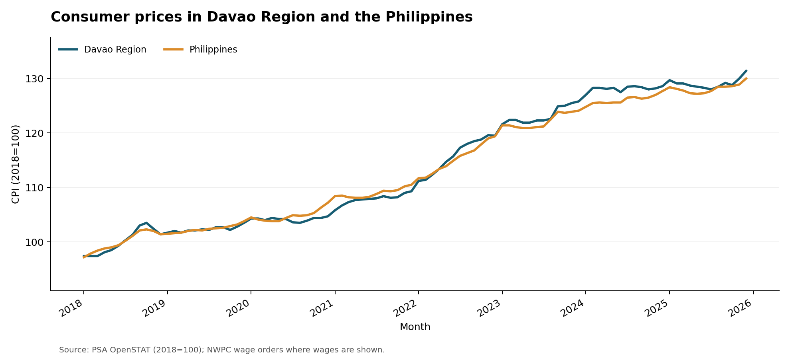
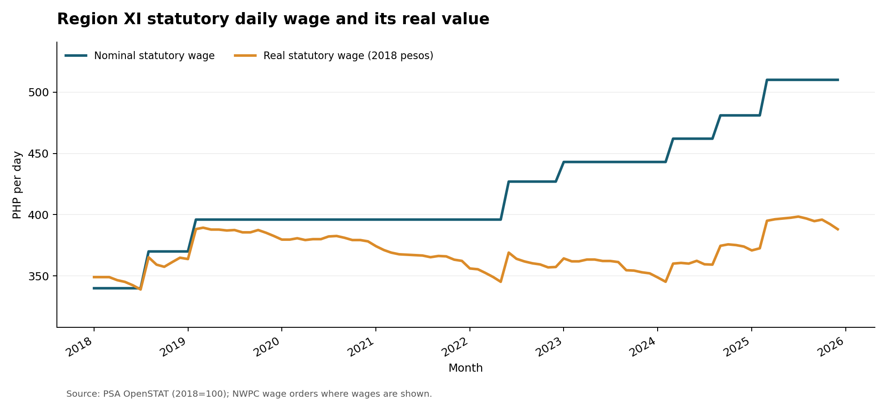
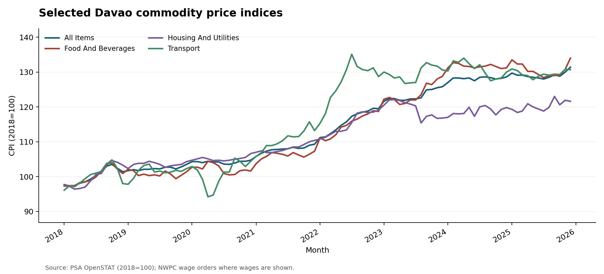
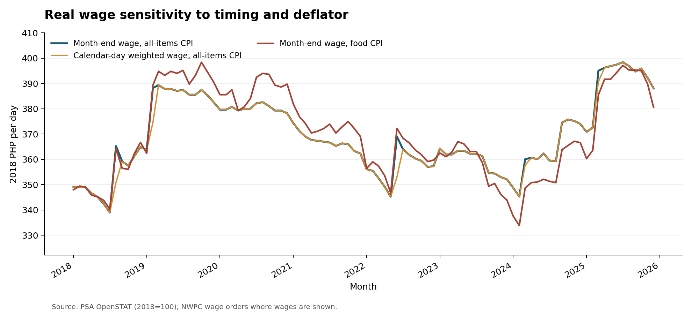

# The Purchasing Power Trap

**Cyril James Lunzaga** · Economic data analytics · Davao Region, Philippines · January 2018–December 2025

> Did statutory minimum-wage increases preserve purchasing power as consumer prices rose? “Trap” is the research question, not a presumed finding.

## Executive summary

The Region XI non-agricultural statutory daily minimum wage rose from **₱340** in January 2018 to **₱510** in December 2025. Davao's all-items CPI rose from **97.4** to **131.4** (2018=100). Deflating the wage by that CPI gives **₱349.08** and **₱388.13** in 2018 pesos, an **11.19% increase** relative to January 2018. The endpoint comparison does not show a sustained statutory-rate purchasing-power loss. Seven individual months were below the January 2018 real-wage benchmark; the lowest was July 2018 at **2.89% below** it. These are legal-rate comparisons, not measured worker income or household welfare.



## Research question and evidence

How do effective-dated wage increases compare with monthly consumer prices, and how does the answer change under a food price deflator? The project uses one consistent PSA 2018-base new-geographic-code CPI series for Davao Region and the Philippines; the national series is a price benchmark only.

- [PSA OpenSTAT CPI](https://openstat.psa.gov.ph/PXWeb/api/v1/en/DB/2M/PI/CPI/2018NEW/0012M4ACP22.px): 768 monthly observations, two geographies and four top-level groups (all items, food and non-alcoholic beverages, housing and utilities, transport), each complete for 96 months.
- [PSA purchasing power of the peso](https://openstat.psa.gov.ph/PXWeb/api/v1/en/DB/2M/PI/CPI/2018NEW/0012M4ACP24.px): 192 observations used to reconcile `100/CPI` against the published rounded series.
- [NWPC historical non-agricultural wage schedule](https://nwpc.dole.gov.ph/summary-of-daily-minimum-wage-rates-per-wage-order-by-region-non-agriculture-1989-present/): eight Region XI effective rates, including the May 2017 baseline. The [Region XI wage-order index](https://nwpc.dole.gov.ph/region-xi/) provides original-order links.

The [PSA 2023 FIES expenditure-share table](https://psa.gov.ph/statistics/income-expenditure/fies/node/1684064928) is identified as secondary context. Its official workbook returned HTTP 403 during this batch; no household expenditure proportions enter the findings. Exact extraction details, vintage caveats, and file hashes are in [data sources](docs/data_sources.md).

## Analytical method

The main monthly measure uses the statutory rate effective on the month's last calendar day. A calendar-day-weighted rate checks sensitivity to mid-month changes. The pipeline calculates month-on-month and year-on-year CPI changes, cumulative change from January 2018, purchasing power of one peso, and indexed wage and CPI trajectories.

`real statutory daily wage in 2018 PHP = nominal statutory daily wage × 100 / CPI`

The wage and price indices both use January 2018=100 for comparison. The official **2018 CPI base** is the annual average, so January 2018 CPI need not equal 100. Food CPI is an alternative deflator, not a worker-specific basket. [Methodology](docs/methodology.md) records assumptions, formulas, and limitations.




## Findings and robustness

Davao all-items prices increased **34.91%** between the endpoints; the comparable national index increased **33.74%**. Davao food CPI reached **134.0** in December 2025, compared with **131.4** for all items. The food-deflated December 2025 wage is **₱380.60** in 2018 pesos, **9.37% above** its own January 2018 baseline. The largest within-month timing difference is June 2022: **₱427** at month end versus a **₱408.40** calendar-day-weighted rate. That sensitivity is not an estimate of paid working days.





The five figures use validated official observations. Local monthly outputs are in `data/processed/`; published summary tables and validation diagnostics are in `reports/tables/`.

## Reproduce

Python **3.9 or newer** is required. The verified local environment used Python 3.9.1, pandas 1.5.3, matplotlib 3.7.1, and requests 2.28.2. From the repository root, use a workspace virtual environment:

```powershell
python -m venv .venv
.\.venv\Scripts\python.exe -m pip install --upgrade pip setuptools
.\.venv\Scripts\python.exe -m pip install -e .
.\.venv\Scripts\python.exe scripts/run_analysis.py --acquire
.\.venv\Scripts\python.exe -m unittest discover -s tests -v
```

`--acquire` downloads the narrow PSA API extracts and NWPC PDF, validates them, and regenerates tables and figures. Omit it for an offline rerun if the original `data/raw/` directory remains available. PSA may revise its live tables; compare refreshed raw-file hashes with [the recorded vintage](docs/data_sources.md). Raw downloads and processed monthly datasets are Git-ignored. Synthetic values occur only in offline tests. The [notebook](notebooks/purchasing_power_analysis.ipynb) reads the same validated outputs.

The pipeline rejects duplicate or missing keys, invalid CPI values, wage coverage gaps, failed joins, an inconsistent 2018 base, and PPP disagreement. The recorded extract has **zero missing or duplicate keys**; maximum PPP difference is **0.00498 peso**, within a 0.006-peso tolerance. Nine offline tests pass in a workspace environment using existing installed dependencies. A fresh dependency download in an empty environment remains to be verified. [Progress and acceptance evidence](docs/project_progress.md) records the review status.

## Limits and next review

The wage measure is a legal benchmark that can differ from actual pay or eligibility. CPI is a representative index, not a family's spending record. The findings are descriptive and do not identify a causal wage-to-price effect. FIES context, original-order exemption review, a final publication check, and visual design remain before release.

`src/purchasing_power/` contains acquisition, preparation, validation, analysis, and plotting. `scripts/run_analysis.py` runs the pipeline; `data/reference/` holds the source-linked wage transcription; `reports/` holds reviewed outputs; `docs/` records provenance and decisions; `tests/` contains offline arithmetic and failure tests.
